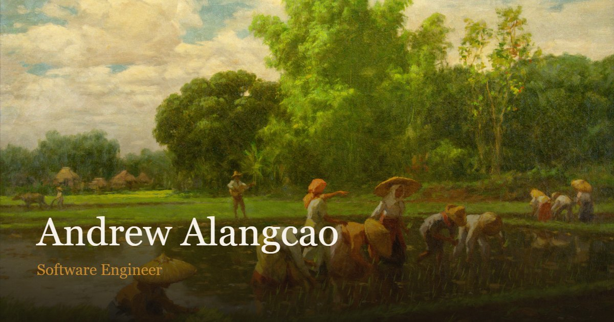

# Andrew Alangcao

**Software Engineer** · [Live site](https://andrewhmir.github.io/) · [GitHub](https://github.com/andrewhmir) · [LinkedIn](https://www.linkedin.com/in/andrew-alangcao/)

A one-page portfolio: a vertical profile painted with two Fernando Amorsolo
landscapes, with the work, leadership, honours and contact details laid out as
one ordinary scroll.



## What's on the page

| Section | What you'll find |
|---|---|
| About | A short bio, a portrait, and links to GitHub and LinkedIn |
| Recently | Dated updates — roles, talks and firsts, newest first |
| Work | Three categories — Applications, DSH Plugins and Robotics — with three projects each |
| Leadership | Roles and organisations, with photographs |
| Honours | Awards and recognitions; entries with photographs open them |
| Contact | Email (click to copy) and the other links |

Clicking a project card opens that project's own full-screen panel. Project,
leadership and honour records all share one accessible dialog — with a video or
a photo gallery — that closes on Escape and returns focus to the card that
opened it.

## Built with

- Plain HTML, CSS and JavaScript. No framework, no bundler, no build step, and
  no package install.
- Content lives in [`js/data.js`](js/data.js); the page is rendered by
  [`js/main.js`](js/main.js).
- Two saved Amorsolo paintings supply the art, cropped per section with CSS
  `background-position`. A direction-aware scrim keeps the copy side dark while
  the far side of the painting stays bright.
- [Lenis](js/vendor/) is vendored locally and adds the smooth wheel glide. Touch,
  the keyboard and reduced motion stay native, and clicking a nav link scrolls
  without changing the URL.
- Newsreader and Courier Prime are vendored locally under the SIL Open Font
  License. Nothing is fetched from a third-party host at runtime.

## Run it locally

Open `index.html` directly, or serve the folder when checking video playback or
fonts:

```powershell
node tools/serve.mjs 3333
# http://127.0.0.1:3333/
```

No install and no build. `npm test` runs the static checks; a change to a CSS or
JS file needs a page refresh (there is no live reload).

## Repository layout

| Path | What's in it |
|---|---|
| `index.html` | The page shell: masthead, journey rail, mount, dialog and footer |
| `css/` | `styles.css` (all styling) and the generated `fonts.css` |
| `js/data.js` | `PORTFOLIO` — every project, role, award and news item |
| `js/main.js` | The renderer, rail, project view and shared dialog |
| `js/vendor/` | Lenis 1.3.26, vendored (MIT) |
| `files/` | Paintings, portrait, photographs, films, posters, fonts and favicon |
| `tests/` | The static guard and the data checks |
| `tools/` | Dev-only scripts: static server, image/font generators, validators |
| `docs/` | Component notes and the design record |

## Deploying

GitHub Pages serves the repository root from `main`: there is no pipeline and no
build, so pushing the working tree publishes it. `.nojekyll` stops Jekyll from
processing the files.

## Design notes

- **Two paintings, not one.** A single painting repeated down the page reads as
  wallpaper; alternating a bright field with a darker harvest gives the page a
  rhythm without a third asset.
- **Readability first.** Copy sits on a gradient scrim that is near-opaque on the
  text side and all but clear on the art side. Measured contrast is 8.3–9.8:1
  across section copy and 12.4:1 on the contact card.
- **One scroll, real navigation.** On desktop a journey rail tracks the section
  in the middle of the viewport and doubles as the page's progress meter. Below
  1024px it is hidden rather than shrunk onto the copy.
- **One dialog.** Project, leadership and honour records share a single modal
  with a focus trap, Escape-to-close and focus restore, instead of three
  one-off overlays.

The design record — why the page moved from a horizontal gallery to a vertical
profile, and how the scrims and rail were measured — is in
[`docs/superpowers/`](docs/superpowers/).

## Credits

- Paintings by Fernando Amorsolo y Cueto (1892–1972): *Planting Rice* (1949) and
  a 1934 harvest scene.
- Newsreader and Courier Prime are vendored under the SIL Open Font License 1.1;
  the licence texts are in [`files/fonts/`](files/fonts/).
- Lenis 1.3.26 is vendored under the MIT licence in [`js/vendor/`](js/vendor/).

## License

All rights reserved.
